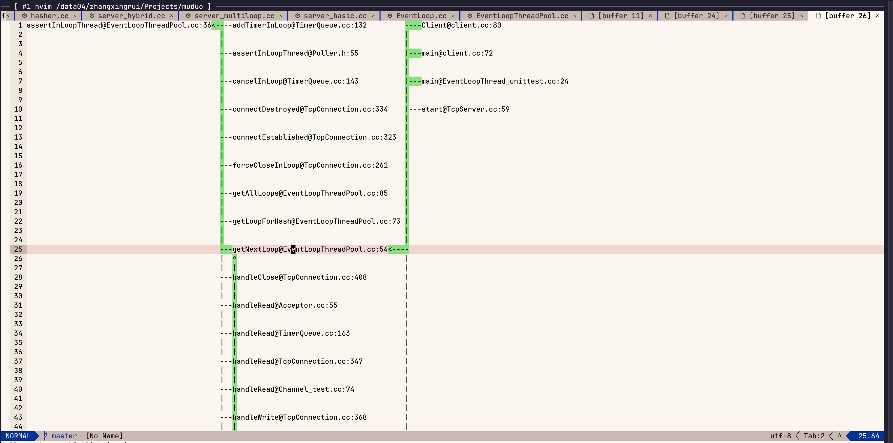

# call-graph.nvim
Inspired by [Sourcetrail](https://github.com/CoatiSoftware/Sourcetrail) and [trails.nvim](https://github.com/kontura/trails.nvim), call-graph.nvim is an interactive ASCII call graph plugin built to help you navigate and understand source code more efficiently.

> This plugin is actively under development. Feedback and contributions are highly welcome.

**Tested thoroughly with the clangd LSP server, this plugin is compatible with any LSP server that supports the `callHierarchy/incomingCalls` capability.**
- The pyright server has been tested and works, but its performance is poor — I do not recommend using it.

## Features
Demoed with the open-source project [muduo](https://github.com/chenshuo/muduo):



- Each node is labeled in the format `func_name/file:line_number` for clear identification.
- Incoming edges represent callee relationships (functions that call the current node), while outgoing edges represent caller relationships (functions the current node invokes).
- Hovering the cursor over a node automatically highlights all its incoming/outgoing edges (configurable toggle and delay).
- Hovering over an edge highlights all overlapping edges (common when multiple call paths exist between two nodes).
- Jump to the corresponding code location for any node or edge with the `gd` shortcut. For overlapping edges, a selection window pops up to let you pick the specific path to jump to.
- Press `K` on a node to display its full file path for better context.
- Export call graphs to Mermaid format and open the generated file with the `CallGraphOpenMermaidGraph` command.
- Access a history of recently generated call graphs: view the list with `CallGraphHistory`, open the most recent graph with `CallGraphOpenLastestGraph`, or clear history with `CallGraphClearHistory`.
- Use Mark Mode to create focused subgraphs: enter mark mode with `CallGraphMarkNode` to mark/unmark nodes of interest, generate a subgraph from marked nodes with `CallGraphMarkEnd`, or exit mark mode without generating a subgraph with `CallGraphMarkExit` (perfect for isolating key relationships in complex call graphs).

## Installation
Install with lazy.nvim:
```lua
{
    "ravenxrz/call-graph.nvim",
    dependencies = {
        "nvim-treesitter/nvim-treesitter",
    },
    opts = {
        log_level = "info",
        auto_toggle_hl = true, -- Toggle automatic highlighting of node/edge relationships
        hl_delay_ms = 200, -- Delay (in milliseconds) for automatic highlighting to trigger
        in_call_max_depth = 4, -- Max search depth for incoming calls
        ref_call_max_depth = 4, -- Max search depth for reference calls
        export_mermaid_graph = false, -- Toggle automatic Mermaid graph export
        max_history_size = 20, -- Max number of call graphs to retain in history
    }
}
```

## Supported Commands
- CallGraphI: Generate a call graph using incoming calls (fast but less comprehensive)
- CallGraphR: Generate a call graph using references + treesitter (slower, opens many files, but more comprehensive; C++ only)
- CallGraphO: Generate an outgoing call graph using treesitter (C++ only)
- CallGraphOpenMermaidGraph: Open the exported Mermaid call graph file
- CallGraphLog: Open the plugin’s log file for debugging
- CallGraphHistory: Show and select from recently generated call graphs
- CallGraphOpenLastestGraph: Open the most recently created call graph
- CallGraphMarkNode: Mark/unmark the node under the cursor (enters mark mode automatically if inactive)
- CallGraphMarkEnd: Exit mark mode and generate a subgraph from marked nodes
- CallGraphMarkExit: Exit mark mode without generating a subgraph (clears all marks)
- CallGraphClearHistory: Clear all call graph history (in-memory and on-disk)

## Highlight Groups
- CallGraphLine: Linked to Search by default (for highlighting node/edge relationships)
- CallGraphMarkedNode: Linked to Visual by default (for marked nodes in mark mode)

## FAQ
1. Jumping from the call graph to the buffer lands on an incorrect location
This may be a bug in Neovim or your LSP server — vim.lsp.buf.incoming_calls may return inaccurate location data. Verify this by running :lua vim.lsp.buf.incoming_calls() and checking the returned location information.
2. The call graph is incomplete
The LSP incomingCalls capability only analyzes files that are open in Neovim, leading to incomplete graphs for unopened files.
Solutions:
Manually jump to relevant nodes (to open their files), then regenerate the call graph from the root node.
Use CallGraphR (C++ only) for a more comprehensive call graph.
